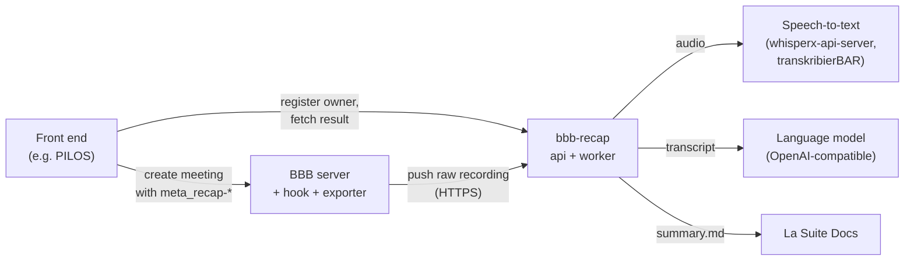

# bbb-recap

bbb-recap turns a recorded [BigBlueButton](https://bigbluebutton.org/) (BBB) meeting into a written summary. A small
exporter on the BBB server pushes the raw recording to the service; the service has it transcribed by a
speech-to-text server and summarized by a language model, renders Markdown from a template for the meeting type, and
delivers it: as a document in the meeting owner's [La Suite Docs](https://github.com/suitenumerique/docs), or as a
file the front end (for example [PILOS](https://github.com/THM-Health/PILOS)) fetches. Nothing is processed unless
the meeting was switched on for it and recorded. Meeting content is deleted right after delivery.

## How it fits together



1. The front end creates the BBB meeting with a few `meta_recap-*` parameters and registers the owner with the
   service.
2. After the recorded meeting ends, a `post_archive` hook on the BBB server queues it; the exporter pushes the raw
   files (events, one audio file per speaker, notes, slides) to the service.
3. The service validates, transcribes, summarizes, renders and delivers the result, then deletes the content.

A longer walk-through: [docs/overview.md](docs/overview.md).

## Features

- Speaker-attributed transcripts from BBB's per-speaker audio tracks (LiveKit audio bridge).
- Providers are configuration: ASR dialects `whisperx-family` and `transkribierbar`, any OpenAI-compatible chat
  completions endpoint for the language model. No vendor SDKs.
- Sinks: La Suite Docs (`create-for-owner`, the owner gets the document) and `frontend` (the front end fetches the
  Markdown).
- Postgres job queue with retries, holds and admin actions (`retry`, `release`, `rerun`, `purge`, `erase`); admin
  API and admin web pages with OIDC login.
- Privacy by default: content is deleted after delivery, logs never contain meeting content, retention is
  configurable.
- One Go binary per component in small `scratch` images; docker compose today, built to run on Kubernetes.

## Limits

- BBB 4.0 or later with the LiveKit audio bridge only; no diarization, so a shared room microphone is one speaker.
- One built-in output format (`meeting-summary`); admin-defined templates are not supported yet.
- The transcript (`transcript.vtt`) is produced but not delivered.
- Front ends need a small integration; PILOS releases do not include one yet.
- No Debian package for the exporter, no Kubernetes manifests and no `linux/arm64` images yet.
- Not tested with real meetings at scale. Whether the service may be used with real meetings is the deploying
  organisation's decision; [docs/reference/privacy.md](docs/reference/privacy.md) is input for that assessment.

## Quick start

- Run the service with docker compose: [docs/operations/install-compose.md](docs/operations/install-compose.md).
- Install the hook and exporter on a BBB server:
  [docs/operations/install-exporter.md](docs/operations/install-exporter.md).
- Optional: an "AI summary" button in BBB that starts and pauses the recording:
  [docs/operations/install-plugin.md](docs/operations/install-plugin.md).
- Develop and test: [AGENTS.md](AGENTS.md) and [CONTRIBUTING.md](CONTRIBUTING.md).

## Try it locally

The end-to-end test runs the whole pipeline on one machine with mock ASR, LLM and Docs, using synthetic fixtures only.
It needs Go, podman with podman-compose, curl and jq:

```sh
podman pull docker.io/library/alpine:3.24 docker.io/library/postgres:18-alpine
make images        # builds localhost/recap:dev, recap-exporter:dev, recap-mock:dev
KEEP=1 tools/e2e/m1.sh   # ingest, registration, summary, delivery to the mock Docs; KEEP=1 leaves the stack up
podman compose -p recap-e2e-m1 -f deploy/compose.yaml -f tools/dev/compose.yaml --env-file tools/dev/dev.env down -v
```

## Repository layout

| Path         | Content                                                                                           |
| ------------ | ------------------------------------------------------------------------------------------------- |
| `cmd/`       | binaries: `recap` (service), `recap-exporter` (BBB side), `recap-mock` (mock providers for tests) |
| `internal/`  | service and exporter code                                                                         |
| `hook/`      | the Ruby `post_archive` hook for BBB                                                              |
| `plugin/`    | the BBB plugin with the "AI summary" button (TypeScript)                                          |
| `formats/`   | built-in output formats (prompts and templates)                                                   |
| `contracts/` | contract tests of the interfaces                                                                  |
| `testdata/`  | synthetic fixtures and golden files                                                               |
| `deploy/`    | images, compose files and config examples for service and exporter                                |
| `tools/`     | fixture generators, contract test environment, dev compose overlay, end-to-end scripts            |
| `docs/`      | overview, reference, decisions, operations                                                        |

## Documentation

| Document                                                             | For                                                                             |
| -------------------------------------------------------------------- | ------------------------------------------------------------------------------- |
| [docs/overview.md](docs/overview.md)                                 | how it works, start here                                                        |
| [docs/reference/](docs/reference/README.md)                          | interfaces, formats, configuration, privacy: the exact rules                    |
| [docs/reference/upstream-facts.md](docs/reference/upstream-facts.md) | facts about BBB, Docs, PILOS and providers this project relies on, with sources |
| [docs/decisions/](docs/decisions/)                                   | architecture decision records: why it is built this way                         |
| [docs/operations/](docs/operations/)                                 | installation, upgrade, releases                                                 |
| [CHANGELOG.md](CHANGELOG.md)                                         | changes per release                                                             |
| [SECURITY.md](SECURITY.md)                                           | reporting vulnerabilities                                                       |

## License

[Apache License 2.0](LICENSE).
