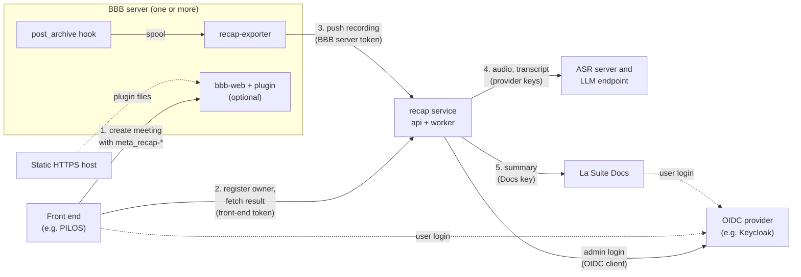

# What to configure where

Read this first. A recap installation connects six parts, and a handful of values must match between them. This page
shows the parts, every shared value with the places it is set and the check that reports a mismatch, and the order
of the steps. The install guides have the commands:

- the service: [install-compose.md](install-compose.md) (`deploy/setup.sh`),
- each BBB server: [install-exporter.md](install-exporter.md) (`deploy/exporter/setup.sh`) and, optionally,
  [install-plugin.md](install-plugin.md).

## The parts

| Part                     | Runs where                                                              | Calls                                              | Guide                                                                                                            |
| ------------------------ | ----------------------------------------------------------------------- | -------------------------------------------------- | ---------------------------------------------------------------------------------------------------------------- |
| BBB server               | hook in BBB's recording worker, exporter in a container on the BBB host | the service (HTTPS, outbound only)                 | [install-exporter.md](install-exporter.md), [install-plugin.md](install-plugin.md)                               |
| recap service            | one Linux host with docker compose, behind a TLS reverse proxy          | ASR, LLM, Docs, OIDC provider                      | [install-compose.md](install-compose.md)                                                                         |
| front end (e.g. PILOS)   | its own host; needs a recap integration                                 | BBB (`create`), the service (registration, result) | [metadata-interface.md](../reference/metadata-interface.md)                                                      |
| La Suite Docs (or other) | its own host                                                            | none (the service calls it)                        | [sinks.md](../reference/sinks.md) §3.4                                                                           |
| ASR and LLM providers    | their own hosts                                                         | none                                               | [providers.md](../reference/providers.md)                                                                        |
| OIDC provider            | its own host                                                            | none                                               | [install-compose.md](install-compose.md#admin-ui-with-keycloak), [deployment.md](../reference/deployment.md) §10 |

## Shared values

Example values are those of the guides. "setup.sh" is `deploy/setup.sh` on the recap host, "exporter setup" is
`deploy/exporter/setup.sh` on a BBB server. Held and failed jobs, with their reason, are listed in the admin UI
(`/admin/`) or by the admin API ([install-compose.md](install-compose.md#troubleshooting)).

| Value                                                                                                                                         | Created where                                                                                                       | Set where (every place)                                                                                                                                                                                                                                                                                                           | A mismatch shows up as                                                                                                                                                                                                                                                          |
| --------------------------------------------------------------------------------------------------------------------------------------------- | ------------------------------------------------------------------------------------------------------------------- | --------------------------------------------------------------------------------------------------------------------------------------------------------------------------------------------------------------------------------------------------------------------------------------------------------------------------------- | ------------------------------------------------------------------------------------------------------------------------------------------------------------------------------------------------------------------------------------------------------------------------------- |
| Release (`v0.3.0`)                                                                                                                            | the release tag                                                                                                     | recap host: `RECAP_IMAGE` in `.env` (setup.sh); each BBB server: exporter image and hook (exporter setup `--version`); the plugin (optional). Upgrade the service first                                                                                                                                                           | an exporter newer than the service: ingest answers `422 unsupported-schema-version` ([meeting-package.md](../reference/meeting-package.md) V-I02), the recording is `failed` in `recap-exporter status`                                                                         |
| Service URL `https://recap.example.org`                                                                                                       | DNS name and TLS reverse proxy to `127.0.0.1:8080` on the recap host                                                | `.env` `RECAP_PUBLIC_BASE_URL` (setup.sh); each BBB server: `RECAP_EXPORTER_SERVICE_URL` in `/etc/recap-exporter/exporter.env` (exporter setup `--service-url`); each front end: its service URL, the base URL without a path                                                                                                     | `curl` on the URL answers `502` instead of `404` (proxy); front end: failed registrations, jobs held `no_registration`; exporter: recordings never `acked` in `recap-exporter status`, connection errors in `docker compose logs exporter`                                      |
| BBB server ID and token (`bbb-1`)                                                                                                             | recap host: `secrets/clients/bbb_server.<id>` (setup.sh, `RECAP_SETUP_BBB_SERVERS`; one ID for a whole BBB cluster) | each BBB server: `RECAP_EXPORTER_BBB_SERVER_ID` in `exporter.env` (`--server-id`), the token in `/etc/recap-exporter/secrets/ingest-token` (asked by exporter setup); optional `.env` `RECAP_FRONTEND_SERVERS`                                                                                                                    | wrong token `401`, ID that does not belong to the token `403 server-mismatch`: the recording is `failed` (`unauthorized`) in `recap-exporter status`; an ID missing from a set `RECAP_FRONTEND_SERVERS`: jobs held `no_registration` (detail `server-not-allowed`)              |
| Front-end ID and token (`pilos-1`)                                                                                                            | recap host: `secrets/clients/frontend.<id>` (setup.sh, `RECAP_SETUP_FRONTENDS`)                                     | the front end: service token (sent as bearer token); optional `.env` `RECAP_FRONTEND_SERVERS`, `RECAP_FRONTEND_TYPES`, `RECAP_FRONTEND_SINKS`                                                                                                                                                                                     | wrong token: the front end's registrations fail with `401`, jobs held `no_registration`; an ID in the `.env` lists without a token file: WARN `front end has no credential file` from `check-config` and the api                                                                |
| Meeting type names (`meeting-summary`)                                                                                                        | recap host: `config/meeting-types.yaml`                                                                             | the front end: `meta_recap-type` on BBB `create` (in the PILOS integration a room type field); optional `.env` `RECAP_FRONTEND_TYPES`                                                                                                                                                                                             | job held `unknown_type` (detail `type-not-allowed` for `RECAP_FRONTEND_TYPES`)                                                                                                                                                                                                  |
| Sink profile names (`docs-main`, `frontend-main`)                                                                                             | recap host: `config/sinks.yaml` (setup.sh `RECAP_SETUP_SINK`)                                                       | the front end: `meta_recap-sink` on BBB `create` (in the PILOS integration a room type field); optional `.env` `RECAP_FRONTEND_SINKS`                                                                                                                                                                                             | job held `unknown_sink` (detail `sink-not-allowed` for `RECAP_FRONTEND_SINKS`)                                                                                                                                                                                                  |
| Meta prefix (default `recap`)                                                                                                                 | fixed; change it only if `meta_recap-*` is taken                                                                    | `.env` `RECAP_META_PREFIX`, each BBB server `RECAP_EXPORTER_META_PREFIX` in `exporter.env`, the keys the front end sends                                                                                                                                                                                                          | the hook logs `not_opted_in` and exports nothing, or ingest answers `422 not-opted-in`                                                                                                                                                                                          |
| Docs URL (`https://docs.example.org`)                                                                                                         | the Docs operator                                                                                                   | recap host: `docs_base_url` in `config/sinks.yaml` (setup.sh `RECAP_SETUP_DOCS_URL`)                                                                                                                                                                                                                                              | unreachable: retried, then job `failed` (`retries_exhausted`); another server answering `4xx`: job `failed` (`rejected_by_sink`); a timeout or `5xx`: job held `delivery_uncertain`                                                                                             |
| Docs server-to-server key                                                                                                                     | Docs: one entry of `DJANGO_SERVER_TO_SERVER_API_TOKENS` ([sinks.md](../reference/sinks.md) §3.4)                    | recap host: `secrets/sinks/docs.key` (setup.sh `RECAP_SETUP_DOCS_KEY`)                                                                                                                                                                                                                                                            | `check-config`: missing or empty file; a wrong key: job `failed` (`config_error`, Docs answered `401` or `403`)                                                                                                                                                                 |
| User realm (owner `sub`)                                                                                                                      | the OIDC provider                                                                                                   | the front end and Docs log users in from the same realm, so the `sub` the front end registers is the one Docs stores; Docs keeps `OIDC_FALLBACK_TO_EMAIL_FOR_IDENTIFICATION` at `true` (its default) unless every `sub` matches ([sinks.md](../reference/sinks.md) §3.3, [identity-mapping.md](../reference/identity-mapping.md)) | Docs finds the owner by email instead, or sends an invitation; two Docs users with that email: job held `owner_unresolved`                                                                                                                                                      |
| Admin UI client: issuer, client ID, client secret, redirect URI `https://recap.example.org/admin/callback`, role `recap-admin`, claim `roles` | the OIDC provider ([install-compose.md](install-compose.md#admin-ui-with-keycloak))                                 | recap host: `.env` `RECAP_OIDC_ISSUER`, `RECAP_OIDC_CLIENT_ID`, `RECAP_OIDC_ROLE_CLAIM` (default `roles`), `RECAP_PUBLIC_BASE_URL`; `secrets/oidc-client-secret`; `secrets/session-key` (generated) (setup.sh `RECAP_SETUP_OIDC_*`)                                                                                               | `check-config`: a missing value or file, a session key under 32 bytes; at login: api log `admin login failed` with `reason` (`discovery-failed`, `code-exchange-failed`, `missing-role`, …)                                                                                     |
| ASR server: URL, model, key                                                                                                                   | the ASR operator                                                                                                    | recap host: profile `asr-main` in `config/providers.yaml`, `secrets/providers/asr.key` (setup.sh `RECAP_SETUP_ASR_*`); whisperx-api-server runs with `RESULT_STORE__ENABLED=false` ([deployment.md](../reference/deployment.md) §10)                                                                                              | `check-config`: unknown dialect, unreadable key file; a rejected key, URL or model (`401`, `403`, `404`): job `failed` (`config_error`); unreachable: every track fails, job `failed` (`all_tracks_failed`)                                                                     |
| LLM endpoint: URL, model, context length, key                                                                                                 | the LLM operator                                                                                                    | recap host: profile `llm-main` in `config/providers.yaml`, `secrets/providers/llm.key` (setup.sh `RECAP_SETUP_LLM_*`)                                                                                                                                                                                                             | `check-config`: unreadable key file, `max_output_tokens` not below `context_tokens`; a rejected key, URL or model: job `failed` (`config_error`); unreachable: job `failed` (`retries_exhausted`); `output_truncated` see [troubleshooting](install-compose.md#troubleshooting) |
| Plugin URL (optional)                                                                                                                         | the static HTTPS host with `RecapPlugin.js` and `manifest.json`                                                     | each BBB server: bbb-web `pluginManifests` ([install-plugin.md](install-plugin.md) step 3)                                                                                                                                                                                                                                        | `curl "$PLUGIN_URL/manifest.json"` fails; no "AI minutes" pill in a recap meeting; a Content Security Policy that forbids inline styles shows BBB's own recording pill next to it                                                                                               |

Network: the worker calls the ASR server, the LLM endpoint and Docs, the api calls the OIDC provider; BBB servers and
front ends call the service. Nothing calls a BBB server. Webhook and Matrix sinks need their own values (receiver URL
and signing secret, bot token): [sinks.md](../reference/sinks.md) §4b, §4c.

Per meeting the front end also sends `record=true`, `meta_recap-enabled=true` (only when the room owner switched recap
on) and `meta_recap-v=1`, and registers the owner after `create`
([metadata-interface.md](../reference/metadata-interface.md) §1.2, §2.2). These are not settings; the recap
integration of the front end sets them.

## Order of the steps

| #   | Where                | Step                                                                                                                                                                                                                                                      |
| --- | -------------------- | --------------------------------------------------------------------------------------------------------------------------------------------------------------------------------------------------------------------------------------------------------- |
| 1   | providers, Docs, IdP | Collect the ASR URL, model and key, the LLM URL, model and key, the Docs URL and a Docs server-to-server key ([sinks.md](../reference/sinks.md) §3.4); for the admin UI, an OIDC client ([install-compose.md](install-compose.md#admin-ui-with-keycloak)) |
| 2   | recap host           | `deploy/setup.sh` ([install-compose.md](install-compose.md#quick-start)): writes the files, creates one token per BBB server and front end, runs `check-config`, starts the service and prints the next steps with the tokens                             |
| 3   | recap host           | DNS name and TLS reverse proxy ([install-compose.md](install-compose.md#quick-start) step 4)                                                                                                                                                              |
| 4   | each BBB server      | `deploy/exporter/setup.sh` with the service URL, the server's ID and token ([install-exporter.md](install-exporter.md#quick-start))                                                                                                                       |
| 5   | each BBB server      | optional: the plugin ([install-plugin.md](install-plugin.md))                                                                                                                                                                                             |
| 6   | front end            | service URL and front-end token in its recap integration; room types name a meeting type and a sink profile from step 2                                                                                                                                   |
| 7   | all                  | a synthetic test meeting: record, stop, end; `recap-exporter status` shows it `acked` ([install-exporter.md](install-exporter.md#quick-start) step 2), the summary arrives in Docs or the front end                                                       |

Add a BBB server or front end later: run `deploy/setup.sh` again and give the new ID (`RECAP_SETUP_BBB_SERVERS`,
`RECAP_SETUP_FRONTENDS`). It keeps every existing file, creates only the new token, shows it, and recreates `api` and
`worker` so that they read it.
