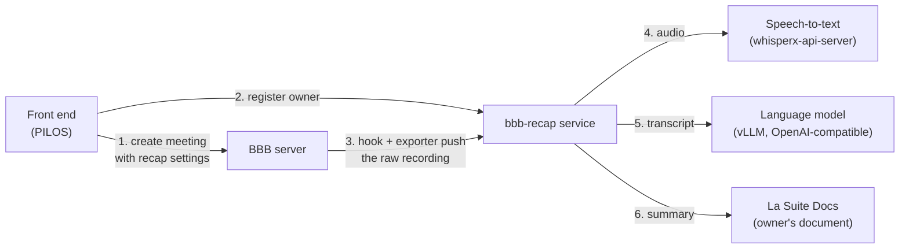
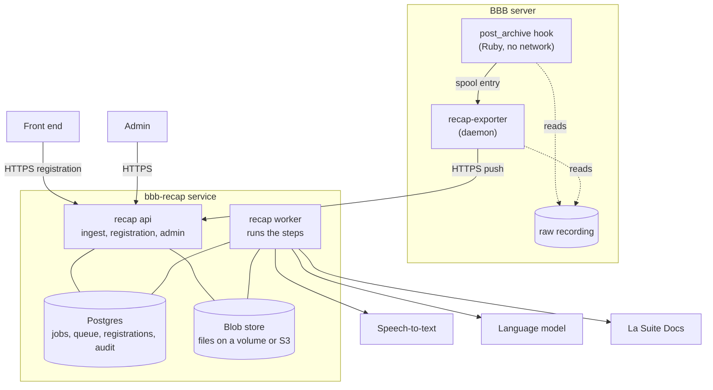
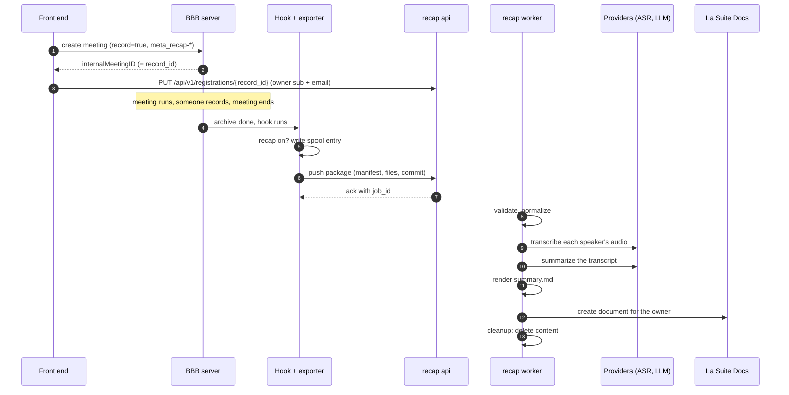
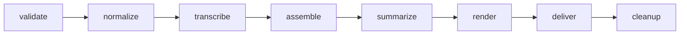
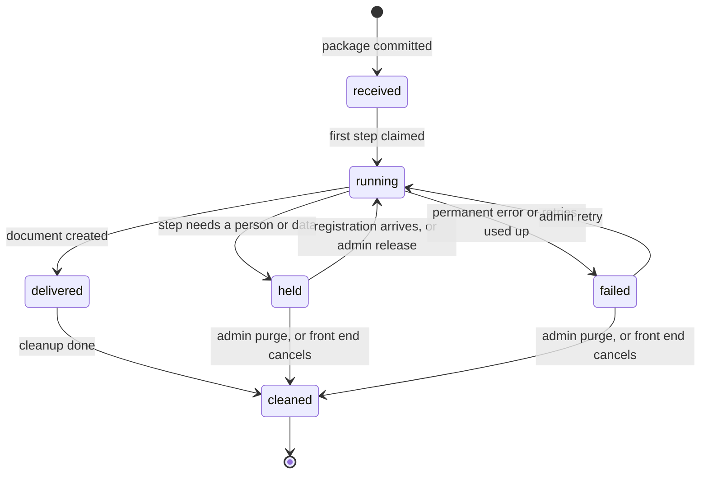
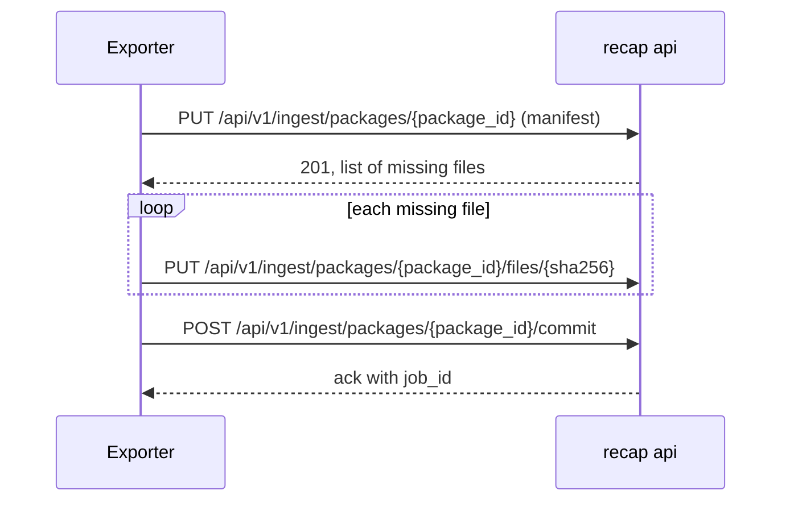
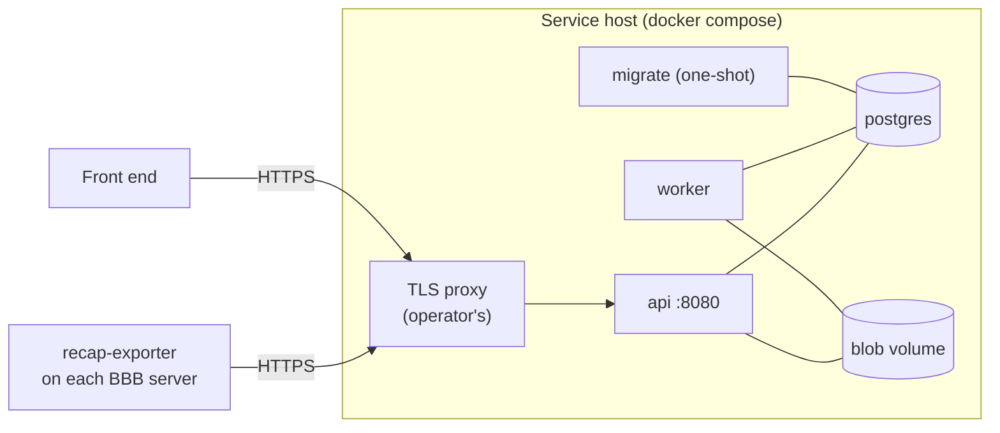

# bbb-recap: how it works

bbb-recap turns a recorded BigBlueButton (BBB) meeting into a written summary and puts it, as a document, into the
meeting owner's La Suite Docs, or hands it to the front end as a Markdown file. It runs as a separate service next to BBB. BBB only hands over the raw recording; the
service gets it transcribed and summarized by configurable outside providers (speech-to-text and a language model) and
delivers the result. Nothing happens unless the meeting was switched on for it and recorded.

This document explains the service for people who operate it or connect a front end (such as PILOS) to it. The most
important parts come first; details follow further down. The exact rules live in the
[reference documents](reference/README.md), which this document links to.

## 1. The short version

- A **front end** (for example PILOS) starts a BBB meeting with a few extra settings that switch recap on, and tells
  the service who owns the meeting.
- When the recorded meeting ends, a small **hook** on the BBB server checks the settings. If recap is on, the
  **exporter** on the same server packs the raw recording and pushes it to the service over HTTPS.
- The **service** checks the package, transcribes each speaker's audio, writes a summary with a language model,
  renders it as Markdown and creates a document for the owner in **La Suite Docs** (or keeps the Markdown for the
  front end to fetch).
- Right after delivery the service **deletes the meeting content**. Only IDs, states and timestamps stay for a while.



## 2. Main ideas

These decisions shape everything else.

| Idea                                  | What it means                                                                                                                                                              |
| ------------------------------------- | -------------------------------------------------------------------------------------------------------------------------------------------------------------------------- |
| Processing happens outside BBB        | The BBB server only exports. It never talks to speech or language models, and it never needs inbound connections.                                                          |
| Two channels, no personal data in BBB | BBB carries only technical settings (on/off, meeting type, target). Who owns the meeting goes straight from the front end to the service.                                  |
| Opt-in and recording both required    | A meeting is processed only if the front end switched recap on **and** someone recorded it.                                                                                |
| Providers are configuration           | Speech-to-text, language model and delivery target are profiles in config files. The core code knows no vendor.                                                            |
| Delete early                          | Meeting content is deleted as soon as the document is delivered. Failed or held jobs keep content until an admin acts.                                                     |
| Simple to run                         | One Go binary in one image, Postgres as database and job queue, files on a volume (or an existing S3). Runs under docker compose today, built so it can run on Kubernetes. |

## 3. The parts



| Part              | Where it runs | Job                                                                                                                                                                                                     |
| ----------------- | ------------- | ------------------------------------------------------------------------------------------------------------------------------------------------------------------------------------------------------- |
| post_archive hook | BBB server    | Runs after BBB archives a recording. Reads the meeting's settings; if recap is on, writes a small "please export" note into a spool directory. No network access.                                       |
| recap-exporter    | BBB server    | Picks up spool notes, builds a package from the raw recording (audio per speaker, events, notes, slides), pushes it to the service, and optionally deletes the raw data after the service confirmed it. |
| `recap api`       | service       | Receives packages and registrations, serves the admin API and admin pages. Never calls providers.                                                                                                       |
| `recap worker`    | service       | Runs the processing steps. The only part that talks to speech-to-text, the language model and Docs.                                                                                                     |
| `recap migrate`   | service       | Creates or updates the database schema, then exits.                                                                                                                                                     |
| Postgres          | service       | Holds jobs, the job queue, registrations and the audit log.                                                                                                                                             |
| Blob store        | service       | Holds the package files and step results while a job runs. A volume under compose, or an existing S3.                                                                                                   |

`api` and `worker` are the same image with different sub-commands. They never talk to each other directly; all
coordination goes through Postgres. Each can run more than once.

## 4. One meeting, start to end



1. The front end creates the BBB meeting with `record=true` and the recap settings (section 6.1).
2. BBB answers with an `internalMeetingID`. This is the **record_id**, the key that later joins the recording with the
   owner.
3. The front end registers the owner (`sub` and email) for that `record_id` with the service.
4. The meeting runs. Someone presses record. The meeting ends and BBB archives the recording.
5. The hook checks the settings and leaves a spool entry for the exporter.
6. The exporter builds the package and pushes it to the service. The service answers with a `job_id` once the package
   is complete and safely stored.
7. The worker runs the steps (section 5): it checks the package, transcribes, summarizes, renders and delivers.
8. Docs creates the document in the owner's account. If the owner has no Docs account yet, Docs invites them by email.
9. The service deletes the meeting content.

With mock providers, steps 5 to 9 take a few seconds. With real models the time is mostly transcription and
summarization.

## 5. Inside the service: jobs and steps

Every pushed package becomes a **job**. A job runs through fixed **steps**, one after the other. Each step is a row in
the job queue in Postgres; workers claim steps, run them and record the result in one transaction. If a worker dies,
its claim expires and another worker picks the step up again. Every step can safely run twice.



| Step         | What it does                                                                                                                                        |
| ------------ | --------------------------------------------------------------------------------------------------------------------------------------------------- |
| `validate`   | Checks the package and its settings, finds the owner's registration, checks the front end may use this meeting type and target.                     |
| `normalize`  | Turns BBB's event log into a clean meeting record: speakers, audio tracks, chat, polls, notes, slides.                                              |
| `transcribe` | Sends each speaker's audio track to speech-to-text. A track that fails becomes a gap; the job fails only if all tracks fail.                        |
| `assemble`   | Merges the per-speaker results into one transcript, ordered by time.                                                                                |
| `summarize`  | Sends the transcript (in parts, if it is long) to the language model and gets a structured summary back.                                            |
| `render`     | Fills the meeting type's template and writes `summary.md` (and a `transcript.vtt`, not delivered yet). All fixed text is in the meeting's language. |
| `deliver`    | Creates the document in Docs for the owner, or stores the summary for the front end (`frontend` sink).                                              |
| `cleanup`    | Deletes all meeting content of the job: files, registration, owner data.                                                                            |

### 5.1 Job states



- **held** means the job waits for something. Some holds clear themselves: if the registration was missing
  (`no_registration`) or Docs could not match the owner (`owner_unresolved`), a new registration from the front end
  resumes the job. Others need an admin, for example an unknown meeting type after a config fix.
- **delivery_uncertain** is a special hold: Docs did not answer clearly (for example a timeout), so the document may
  or may not exist. The service never retries this on its own, because that could create a duplicate. An admin checks
  Docs and then either confirms (`release`) or sends again (`retry`).
- **failed** jobs keep their content until an admin retries or purges them.
- **cleaned** is the end. It carries an outcome: `delivered`, `cancelled` (the front end cancelled) or `purged` (an
  admin removed it).

Retries are automatic, with growing waits (30 seconds up to 30 minutes). Each step has a fixed maximum of attempts.

## 6. Interfaces

All interfaces are HTTPS with JSON. Every caller has its own bearer token, and the caller's identity comes from that
token, never from the request body. Errors use the standard problem format (RFC 9457) with a short code, never with
personal data.

### 6.1 Front end → BBB: meeting settings

The front end adds these parameters to the **first** BBB `create` call of a meeting:

```
record=true&meta_recap-v=1&meta_recap-enabled=true&meta_recap-type=meeting-summary&meta_recap-sink=docs-main
```

| Parameter            | Value  | Meaning                                                                           |
| -------------------- | ------ | --------------------------------------------------------------------------------- |
| `meta_recap-v`       | `1`    | Version of this interface.                                                        |
| `meta_recap-enabled` | `true` | Switches recap on. Any other value means off.                                     |
| `meta_recap-type`    | a name | The meeting type, which picks the summary template (built in: `meeting-summary`). |
| `meta_recap-sink`    | a name | The delivery target profile configured in the service (for example `docs-main`).  |

These values can be seen by meeting participants, so they never contain names, emails, IDs or secrets. Without
recording (no one pressed record), BBB does not run the hook and nothing is exported.

Details: [`reference/metadata-interface.md`](reference/metadata-interface.md) §1.

### 6.2 Front end → service: registration API

Right after `create`, the front end registers the owner under the `record_id` (BBB's `internalMeetingID`).

| Call                                               | Purpose                                                                                                                        |
| -------------------------------------------------- | ------------------------------------------------------------------------------------------------------------------------------ |
| `PUT /api/v1/registrations/{record_id}`            | Register or update the owner. Safe to repeat.                                                                                  |
| `GET /api/v1/registrations/{record_id}`            | Read the registration and, once the package arrived, its job state; after delivery, the result (outcome, time, document link). |
| `DELETE /api/v1/registrations/{record_id}`         | Cancel: no summary will be made; content is deleted. Not possible once delivery has started.                                   |
| `GET /api/v1/registrations/{record_id}/summary`    | `frontend` sink only: fetch the summary as Markdown.                                                                           |
| `DELETE /api/v1/registrations/{record_id}/summary` | `frontend` sink only: confirm the pickup; the service deletes the summary.                                                     |

Request body:

```json
{
  "schema_version": "1.0.0",
  "meeting_id": "room-42",
  "record_id": "536c0e9585fba3ee1c984b5af671f5be7ec5cf96-1761732000000",
  "owner": {
    "sub": "<OIDC subject as Docs knows it>",
    "email": "owner@example.org"
  }
}
```

`meeting_id` is the `meetingID` the front end used in `create`. The answer never contains the owner. A registration
that comes late is fine: the job waits and resumes when it arrives. A registration that never matches a recording
expires after 14 days. After delivery the registration stays as a small result record, without the owner, for
`RECAP_RESULT_TTL` (default 7 days), so the front end can show the result in the room.

Optionally, each front end can be limited to certain BBB servers, meeting types and targets (`RECAP_FRONTEND_SERVERS`,
`RECAP_FRONTEND_TYPES`, `RECAP_FRONTEND_SINKS`). The server limit matters when several organisations share one service.

Details: [`reference/metadata-interface.md`](reference/metadata-interface.md) §2, owner identity in
[`reference/identity-mapping.md`](reference/identity-mapping.md).

### 6.3 Exporter → service: ingest API

The exporter pushes a package in three stages. A package is identified by its `package_id`, the SHA-256 of its
manifest, so a push can always be resumed or repeated without creating a second job.



| Call                                                      | Purpose                                                                                                                    |
| --------------------------------------------------------- | -------------------------------------------------------------------------------------------------------------------------- |
| `PUT /api/v1/ingest/packages/{package_id}`                | Send the manifest (file list with hashes and sizes, meeting settings). The answer lists the files still missing.           |
| `PUT /api/v1/ingest/packages/{package_id}/files/{sha256}` | Upload one file. The service checks its hash.                                                                              |
| `POST /api/v1/ingest/packages/{package_id}/commit`        | Finish. In one transaction the package is marked complete and the job is created. Only then does the exporter get its ack. |
| `GET /api/v1/ingest/packages/{package_id}`                | Ask for the state of a push (for resuming).                                                                                |

The package contains only what the summary needs: the event log, one audio file per speaker, the shared notes as text
and the slides. Camera video, screen share, and the learning dashboard stay on the BBB server.

Details: [`reference/bbb-exporter.md`](reference/bbb-exporter.md) §6, package contents in
[`reference/meeting-package.md`](reference/meeting-package.md).

### 6.4 Admin API and admin pages

| Call                                        | Purpose                                                                                                 |
| ------------------------------------------- | ------------------------------------------------------------------------------------------------------- |
| `GET /api/v1/admin/jobs`                    | List jobs, newest first, with filters (state, held reason, outcome, BBB server, time).                  |
| `GET /api/v1/admin/jobs/{job_id}`           | One job: state, reason, delivery state and Docs document ID.                                            |
| `POST /api/v1/admin/jobs/{job_id}/{action}` | Act on a job: `retry`, `release`, `rerun`, `purge`, `erase`.                                            |
| `GET /api/v1/admin/audit`                   | Who did what, when.                                                                                     |
| `/admin/`                                   | Web pages for the same tasks, with login through the organisation's OIDC provider (role `recap-admin`). |

| Action    | When                                                              | Effect                                                                                                                                     |
| --------- | ----------------------------------------------------------------- | ------------------------------------------------------------------------------------------------------------------------------------------ |
| `retry`   | job failed, or delivery uncertain and the admin found no document | Run the failed step again.                                                                                                                 |
| `release` | job held                                                          | Continue. For an uncertain delivery: the admin found the document, so mark it delivered.                                                   |
| `rerun`   | job not yet cleaned                                               | Start a new job from the same package (creates a new document).                                                                            |
| `purge`   | job held or failed                                                | Delete the content and end the job.                                                                                                        |
| `erase`   | job cleaned                                                       | Remove every remaining trace of the job (data-subject request). Returns the Docs document ID so the Docs operator can delete the document. |

The admin API and pages never show transcripts, summaries, audio, names or email addresses. Every action is written
to the audit log.

Details: [`reference/architecture.md`](reference/architecture.md) §4, §5.4, §11.

### 6.5 Service → providers and Docs

| Target         | How                                                                                                                             | Configured in                        |
| -------------- | ------------------------------------------------------------------------------------------------------------------------------- | ------------------------------------ |
| Speech-to-text | whisperx-api-server or transkribierBAR, one request per speaker track                                                           | `providers.yaml` (provider profiles) |
| Language model | any OpenAI-compatible server, e.g. vLLM, with a JSON schema for the answer                                                      | `providers.yaml`                     |
| Docs           | La Suite Docs `create-for-owner` with a server-to-server key; Docs makes the owner the document owner, or invites them by email | `sinks.yaml` (sink profiles)         |
| Front end      | no call: the `frontend` sink keeps the summary until the front end fetches it                                                   | `sinks.yaml`                         |

Meeting types (`meeting-types.yaml`) map each type to a **format**: the template and instructions that shape the
summary. Formats are plain files shipped with the image. Adding a new provider means adding an adapter behind the
existing interface; the steps do not change.

Details: [`reference/providers.md`](reference/providers.md), [`reference/sinks.md`](reference/sinks.md),
[`reference/templates.md`](reference/templates.md).

### 6.6 Operations endpoints

On a separate port (`9090`), not exposed outside: `GET /healthz` (process alive), `GET /readyz` (database reachable
and schema up to date) and `GET /metrics` (Prometheus). The exporter has its own `/readyz` and `/metrics` on
`127.0.0.1:9466` on the BBB server.

## 7. Privacy and data

| Data                                                             | Where                   | How long                                                                                    |
| ---------------------------------------------------------------- | ----------------------- | ------------------------------------------------------------------------------------------- |
| Package and all step results (audio, transcript, summary)        | blob store              | until delivery, then deleted at once; held or failed jobs until an admin acts               |
| Owner `sub` and email                                            | Postgres (registration) | until the job is cleaned; unmatched registrations 14 days                                   |
| Summary for the `frontend` sink                                  | service                 | until the front end fetched it, at most `RECAP_RESULT_TTL` (7 days)                         |
| Result record (IDs, times, document link)                        | Postgres                | `RECAP_RESULT_TTL` (7 days) after delivery                                                  |
| Job metadata (IDs, states, times, error codes, Docs document ID) | Postgres                | 180 days                                                                                    |
| Audit log                                                        | Postgres                | 180 days                                                                                    |
| Raw recording                                                    | BBB server              | BBB's own rules; optionally deleted by the exporter after the service confirmed the package |
| The summary document                                             | La Suite Docs           | owned by the meeting owner                                                                  |

Logs contain IDs and codes only, never names, emails, transcript or summary text. Data sent to providers stays under
the provider profile's own retention, which the operator declares.

Details: [`reference/privacy.md`](reference/privacy.md).

## 8. Running it



- **Service:** `deploy/compose.yaml` runs `postgres`, `migrate`, `api` and `worker`. Blobs go to a shared volume;
  set `RECAP_BLOB_BACKEND=s3` to use an existing S3 instead. TLS ends at the operator's proxy. For development, the
  overlay `tools/dev/compose.yaml` adds mock providers, a local test S3 and a TLS front.
- **BBB server:** the hook goes into BBB's `post_archive` scripts directory (on a docker-based BBB it is mounted into
  the recording container); the exporter runs as a container under its own user. There is no Debian package yet.
- **Configuration:** environment variables first; three YAML files for meeting types, providers and sinks. Secrets
  come only from files.

Details: [`reference/deployment.md`](reference/deployment.md); step-by-step guides:
[install the service](operations/install-compose.md), [install the exporter](operations/install-exporter.md).

## 9. Status

- **Tested end to end:** BBB 4.1 (docker-based setup) to a La Suite Docs document and to the `frontend` sink, with
  whisperx-api-server and an OpenAI-compatible language model, and with mock providers in CI.
- **Built, less tested:** admin web pages with OIDC login, `erase`, per-front-end allow-lists, the transkribierBAR
  adapter, the exporter on a packaged (Debian) BBB.
- **Not yet:** a front-end integration in a PILOS release, a Debian package for the exporter, Kubernetes manifests,
  `linux/arm64` images.
