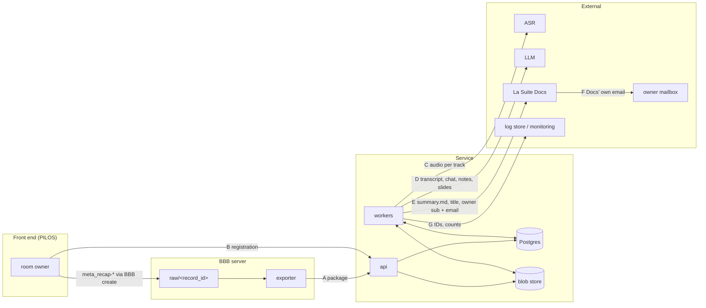

# Privacy: data inventory, flows, retention, deletion, logging

What personal data the service handles, where it goes, how long it stays and who deletes it. Decision: ADR-009.
Related: ADR-002, ADR-004 to ADR-008, ADR-011 in [`../decisions/`](../decisions/). Names and config defaults:
[`README.md`](README.md).

This is engineering input for a data protection impact assessment (DPIA), **not** a legal assessment. The legal
assessment (legal basis, DPIA, approval for production use) is the deploying organisation's task (marked `operator`
below).

## 1. Principles

1. Opt-in per meeting (`meta_recap-enabled=true`, ADR-005) plus the record button (ADR-002). No opt-in, no job.
2. Minimisation: the package holds only allow-listed files (ADR-004). Video, deskshare and learning dashboard stay on BBB.
3. No personal data in our `meta_*` keys; owner identity goes through the registration API (ADR-005, ADR-006).
4. Content is deleted right after successful delivery by default (ADR-009).
5. No content in logs at INFO or above (README "Logging").
6. Every external processor is a configured profile that declares location and retention (§7).
7. Approval for production use is the deploying organisation's decision, outside this project (§9).

## 2. Data flows

| Edge                   | Personal data                                                                                                                                                | Auth                       | Stored / deleted                            |
| ---------------------- | ------------------------------------------------------------------------------------------------------------------------------------------------------------ | -------------------------- | ------------------------------------------- |
| A BBB → service        | voice per speaker, display names, user IDs, chat, polls, talk times, notes, slides; `events.xml` as is, incl. any personal data other front ends put in meta | per-server credential, TLS | raw: exporter (ADR-002); package: `cleanup` |
| B front end → service  | owner `sub`, email, `meeting_id`                                                                                                                             | per-front-end credential   | service; `cleanup`                          |
| C service → ASR        | voice                                                                                                                                                        | provider profile           | provider, per declaration                   |
| D service → LLM        | transcript, names, chat, notes, polls; text of the slides shown during recording, only for meeting types that switch slides on (`templates.md` §3.1)         | provider profile           | provider, per declaration                   |
| E service → Docs       | summary (may name people), title (meeting name + date), owner `sub` + email                                                                                  | s2s key (`sinks.md` §3.2)  | Docs; owner manages                         |
| F Docs → mailbox       | owner email, title                                                                                                                                           | Docs' mail setup           | mail systems                                |
| G service → monitoring | none by rule (§6)                                                                                                                                            | —                          | operator policy                             |

The transcript (`transcript.vtt`) is **not** sent anywhere yet. There is no service email and no SMTP edge.

Slides on edge D (ADR-015) are off by default; switching them on for a meeting type is the operator's decision. Then
only the cleaned text of pages shown for at least 5 s during recording is sent, capped in size. Never sent: slide
images, pages that were not shown, the default deck, presentation IDs and original file names. Slide text can hold
personal data (names on title pages, participant lists, figures).

## 3. Data inventory

"As S1" = deleted by `cleanup` right after delivery; held/failed: kept until an admin acts.

### 3.1 BBB server

| ID  | Item                                                    | Personal data                                                                                                                          | Retention                                                                                                                                                 | Deleter                             |
| --- | ------------------------------------------------------- | -------------------------------------------------------------------------------------------------------------------------------------- | --------------------------------------------------------------------------------------------------------------------------------------------------------- | ----------------------------------- |
| B1  | Raw recording `raw/<record_id>`                         | voice, video, screen, names, user IDs, chat, polls, notes, slides                                                                      | `RECAP_EXPORTER_DELETE_POLICY` default `never`; BBB's daily cron never deletes raw if all formats are disabled ([`upstream-facts.md`](upstream-facts.md)) | exporter (`after_ack`) or BBB admin |
| B2  | Spool entry                                             | `record_id` only                                                                                                                       | seconds                                                                                                                                                   | exporter                            |
| B3  | Exporter state record                                   | `meeting_id`, user IDs in file names                                                                                                   | 30 days after `acked`/`deleted` (constant, `bbb-exporter.md` §5.4)                                                                                        | exporter                            |
| B4  | `meta_*` in events.xml, `metadata.xml`, `getRecordings` | ours: none. Other front ends may add some, e.g. Moodle can put the creator's name and email ([`upstream-facts.md`](upstream-facts.md)) | as B1; BBB copies meta into the published `metadata.xml` (see Known limitations)                                                                          | BBB admin                           |

### 3.2 Service

| ID  | Item                                                                | Personal data                                                                         | Storage                                           | Retention                                                                                  | Deleter                                                     |
| --- | ------------------------------------------------------------------- | ------------------------------------------------------------------------------------- | ------------------------------------------------- | ------------------------------------------------------------------------------------------ | ----------------------------------------------------------- |
| S0  | Ingest staging                                                      | as S1                                                                                 | blob store + `packages` rows                      | `RECAP_INGEST_STAGING_TTL` (72h)                                                           | cleanup loop                                                |
| S1  | Package (`manifest.json`, `events.xml`, audio, notes, presentation) | edge A                                                                                | blob store `jobs/<job_id>/sha256/<hex>` (ADR-011) | after delivery: immediately                                                                | `cleanup` / admin                                           |
| S2  | Registration                                                        | owner `sub`, email, `meeting_id`                                                      | Postgres                                          | as S1; unmatched: `RECAP_REGISTRATION_TTL` (14d); tombstone (IDs only): 30 days (constant) | `cleanup`, cleanup loop                                     |
| S3  | Normalized data, audio per track                                    | voice, names, chat, polls, notes, text of shown slides (`templates.md` §3.1)          | blob store                                        | as S1                                                                                      | `cleanup`                                                   |
| S5  | ASR results, transcript JSON, LLM map outputs, summary JSON         | speech, names, summary                                                                | blob store                                        | as S1                                                                                      | `cleanup`                                                   |
| S6  | `summary.md`, `transcript.vtt`, delivery request                    | summary, transcript, title, owner `sub` + email                                       | blob store / step input                           | as S1 (`transcript.vtt` is never delivered)                                                | `cleanup`                                                   |
| S7  | Delivery record                                                     | Docs document ID, state (`sinks.md` §1.3)                                             | Postgres                                          | as J1                                                                                      | cleanup loop                                                |
| S9  | Result record (`metadata-interface.md` §2.7)                        | IDs, times, `document_url`; no owner identity                                         | Postgres (`registrations`)                        | `RECAP_RESULT_TTL` (7d) after delivery                                                     | cleanup loop                                                |
| S10 | Summary for pickup (`frontend` sink, `sinks.md` §4a)                | summary text: speaker and action-item names, meeting content                          | blob store `results/<job_id>/`                    | until the front end's pickup, at most `RECAP_RESULT_TTL`                                   | front end (`DELETE …/summary`), cleanup loop, admin `erase` |
| S8  | Worker temp files                                                   | step content                                                                          | container scratch, no host path                   | end of step                                                                                | worker                                                      |
| J1  | Job metadata                                                        | IDs, states, timestamps, error codes. Pseudonymous: linkable via BBB, front end, Docs | Postgres                                          | `RECAP_JOB_METADATA_RETENTION` (180d)                                                      | cleanup loop                                                |
| J2  | Logs                                                                | IDs, codes (§6)                                                                       | operator log store                                | log store policy (`operator`)                                                              | operator                                                    |
| J3  | Metrics                                                             | none                                                                                  | Prometheus                                        | operator policy                                                                            | operator                                                    |
| J4  | Admin audit log                                                     | admin identity, action, `job_id`                                                      | Postgres                                          | as J1                                                                                      | cleanup loop                                                |
| J5  | Backups                                                             | anything present at backup time                                                       | backup system                                     | backup policy (§5.4)                                                                       | operator                                                    |

### 3.3 Outside the service

| ID  | Item                                       | Personal data                                   | Retention                                                                                                                              | Deleter                              |
| --- | ------------------------------------------ | ----------------------------------------------- | -------------------------------------------------------------------------------------------------------------------------------------- | ------------------------------------ |
| P1  | ASR copies                                 | voice, transcript                               | per declaration; whisperx-api-server result store on by default, 1 h TTL, recommend off ([`upstream-facts.md`](upstream-facts.md))     | adapter `cleanup`, provider operator |
| P2  | LLM copies                                 | transcript, summary, slide text (if sent)       | per declaration (see Known limitations)                                                                                                | provider operator                    |
| D1  | Docs summary document                      | summary, title                                  | until deleted in Docs                                                                                                                  | owner; Docs operator if ownerless    |
| D2  | Docs owner invitation (unknown owner only) | owner email                                     | valid 7 days ([`upstream-facts.md`](upstream-facts.md)); no purge of expired invitations found. After expiry the document is ownerless | Docs operator                        |
| D3  | Docs emails                                | owner email, title                              | mail policy                                                                                                                            | mail operator, owner                 |
| F1  | Front-end copy (ADR-014)                   | summary text or document link, meeting and room | front end's policy; PILOS: recording retention, access per summary like recordings                                                     | front end, room owner                |

## 4. Retention configuration

README names and defaults; full list in `deployment.md` §5.

| Setting                                    | Default         | Covers                                    |
| ------------------------------------------ | --------------- | ----------------------------------------- |
| `RECAP_RETENTION_AFTER_DELIVERY`           | `0` (immediate) | S1–S3, S5, S6 after `delivered`           |
| `RECAP_JOB_METADATA_RETENTION`             | `180d`          | J1, J4, S7                                |
| `RECAP_REGISTRATION_TTL`                   | `14d`           | unmatched S2                              |
| `RECAP_RESULT_TTL`                         | `7d`            | S9, S10 after delivery                    |
| `RECAP_INGEST_STAGING_TTL`                 | `72h`           | S0                                        |
| `RECAP_EXPORTER_DELETE_POLICY`             | `never`         | B1 (`after_ack` waits 24 h after the ack) |
| `RECAP_EXPORTER_DELETE_AFTER_FAILURE_DAYS` | `0` (off)       | B1 after export failure                   |

Fixed constants, not settings: tombstones 30 days, exporter delete grace 24 h, exporter state retention 30 days.
Held and failed jobs keep content until an admin acts; there is no automatic deletion. `delivery_uncertain`
is a held state, so content stays until `release` or `retry` (`sinks.md` §1.7).

## 5. Deletion

### 5.1 `cleanup` step

1. Ask the ASR adapter to delete each submitted track, where the dialect supports it (`providers.md`). LLM calls are stateless; the declaration covers them.
2. Delete blob prefix `jobs/<job_id>/`, including `transcript.vtt`.
3. Delete the owner identity of the registration (S2) in Postgres; the row stays as the result record (S9) until
   `RECAP_RESULT_TTL` (with `0`, the row is deleted here). The delivery request (S6) goes with the blob prefix. The
   `frontend` sink's summary (S10) is outside the job prefix and stays until pickup or its TTL.
4. Record counts and provider cleanup results in job metadata. Every sub-step is idempotent.

### 5.2 Verification

- The prefix must list empty and no personal-data column may remain, else the step retries.
- `cleanup` also deletes the job's `package_files` rows: their paths contain BBB user IDs (pseudonymous). Job
  metadata keeps only the package's file count and total size.
- A provider cleanup that keeps failing: the job continues; `recap_external_requests_total{kind="asr_cleanup"}` alerts.
- CT-PRIV-01: after `cleanup` on fixture jobs (filesystem and MinIO) nothing remains. CT-PRIV-02: §6 log scan.

### 5.3 Cleanup loop

Hourly in every worker (`architecture.md` §8): deletes S0, unmatched S2, tombstones, S9 and S10 past their limits, and J1, J4,
S7 older than `RECAP_JOB_METADATA_RETENTION`. Logs counts only.

### 5.4 Admin deletion, erasure, backups

- `purge` on a held/failed job runs §5.1–5.2 and ends it `cleaned`/`purged`; the admin is recorded in J4.
- `erase`: data-subject erasure of one job. Allowed only on a `cleaned` job (content S1–S6 is already
  gone; a `held` or `failed` job is purged first, a running one is cancelled or waited for); else `409
invalid-job-state`. In one transaction it deletes the job's rows (J1: `jobs`, `steps`), its delivery record (S7),
  its `packages` and `package_files` rows, any registration, result record or tombstone row for its `record_id` (S2,
  S9) and its audit rows (J4), the blob prefix `jobs/<job_id>/` again (idempotent) and a waiting `frontend` summary
  `results/<job_id>/` (S10, ADR-014). It then writes one audit row `erase` with the
  admin identity, `job_id` NULL and no detail, so the erasure itself is accountable without linking to the subject.
  Rows another job still needs (a `rerun` pair shares the package and the registration) stay, but no row may keep the
  erased `job_id`: `packages.job_id` moves to the newest remaining job of that package, and that job's `rerun_of`
  becomes NULL. A rerun chain is erased with one `erase` per job. The response carries the Docs document ID and sink profile (or null) for the Docs operator, who deletes the
  document (the service has no rights on it, ADR-007). A second `erase` of the same ID is `404`.
- Backups: a restore can bring back deleted data. This is accepted. After a restore, the cleanup loop removes blob
  prefixes of cleaned or unknown jobs (`architecture.md` §8).
- Operator checklist: S3 versioning off (or short expiry of old versions); worker scratch not a host path;
  whisperx-api-server `RESULT_STORE__ENABLED=false` or TTL declared.

## 6. Logging rules

README "Logging" applies. In addition, for service, exporter and hook:

1. Never at any level: content, titles, names, emails, OIDC `sub`, keys, tokens, `Authorization` headers.
2. DEBUG may add HTTP method, path, status, allow-listed headers and body **lengths**. Never bodies.
3. Upstream error bodies are reduced to an allow-listed code before logging or storing.
4. Stack traces must not contain payloads. Admin content views go to J4, not the log.
5. CT-PRIV-02 runs the fixture pipeline at DEBUG and fails on any fixture content, name, email, `sub` or secret.

## 7. Provider and sink declarations

An ASR, LLM or sink profile **may** have a `declaration` block (optional, so pilots and staging can run without one).
A profile without one logs one WARN at start-up and in `check-config` ("profile <name> has no
declaration"). A declaration that is present must be complete and valid as below, or the service refuses to start.

| Field                        | Values                                                                                        |
| ---------------------------- | --------------------------------------------------------------------------------------------- |
| `data_categories`            | from §3, e.g. `[voice]`, `[summary, email]`; `slides` for an LLM profile that gets slide text |
| `operator`                   | who runs it                                                                                   |
| `location`                   | `on_prem`, `eu`, `eea`, `third_country:<code>`                                                |
| `retention`                  | free text + duration                                                                          |
| `deletion`                   | `adapter_cleanup`, `ttl:<duration>`, `none`, `manual`                                         |
| `used_for_training`          | `no`, `yes`, `unknown`                                                                        |
| `contract_ref`               | DPA reference or `none`                                                                       |
| `reviewed_by`, `reviewed_at` | role, date                                                                                    |

Third-country and training-using providers should not be used in pilots. A declared profile with such values logs a
WARN at start-up. The declarations feed the DPIA processor list; a deployment without them has to
document its processors elsewhere.

## 8. Cross-reference

| Interface        | Personal data      | Reference                                      |
| ---------------- | ------------------ | ---------------------------------------------- |
| `meta_recap-*`   | none allowed       | `metadata-interface.md`                        |
| Registration API | owner `sub`, email | `metadata-interface.md`, `identity-mapping.md` |
| Package          | edge A             | `meeting-package.md`                           |
| Providers        | edges C, D         | `providers.md`                                 |
| Docs sink        | edges E, F         | `sinks.md`                                     |

## 9. Accepted risk (pilot only)

For pilot use, ADR-009 accepts: no participant notice, no per-participant consent, no legal review in this project.
Also accepted:

- the meeting name in the Docs title, which Docs shows in its emails ([`upstream-facts.md`](upstream-facts.md));
- `events.xml` shipped as is. Fine for PILOS. Before adding another front end, check what it writes into meta.

Conditions: informed participants only; on-prem or contracted providers (§7); pilots bounded by a per-front-end
allow-list of meeting types (`RECAP_FRONTEND_TYPES`), enabled in the front end per room type; synthetic fixtures in
development. **Approval for production use is the deploying organisation's decision** (legal assessment, DPIA, works
council), outside this project.

## 10. Artefacts for a later DPIA

| Artefact                                                                  | Source                                                               |
| ------------------------------------------------------------------------- | -------------------------------------------------------------------- |
| Processing description and purposes                                       | [`../overview.md`](../overview.md), §1–2                             |
| Inventory, retention, deleters                                            | §3, §4                                                               |
| Data-flow diagram                                                         | §2                                                                   |
| Processor list                                                            | §7 declarations of deployed profiles                                 |
| Legal basis per item                                                      | `operator`                                                           |
| Technical and organisational measures                                     | `deployment.md`, `architecture.md`, §5, §6                           |
| Deletion concept and evidence                                             | §5, cleanup metrics, CT-PRIV-01/02                                   |
| Participant notice, consent                                               | not provided by the service                                          |
| Risk register                                                             | §9, ADR-009                                                          |
| Special categories (voice; content may reveal health, union membership …) | `operator`                                                           |
| Data-subject rights                                                       | §5.4; front-end and Docs operator roles                              |
| Docs-side processing (invitations, emails, ownerless documents)           | `sinks.md` §3.3, Docs operator                                       |
| BBB-side retention                                                        | ADR-002, `bbb-exporter.md`, [`upstream-facts.md`](upstream-facts.md) |

## Sources

ADR-002, ADR-004 to ADR-011; external facts (BBB cron and meta handling, Moodle meta, Docs invitations and emails,
whisperx-api-server result store) with their sources in [`upstream-facts.md`](upstream-facts.md).

## Known limitations

- Log store retention and access are the operator's policy; the service only guarantees content-free logs (§6).
- Documents whose owner never accepts the Docs invitation become ownerless after 7 days and still hold personal data.
  Cleaning them up is the Docs operator's task; whether a Docs admin can recover them is not checked.
- `erase` cannot delete in Docs (the service has no rights after delivery). It reports the document ID to the Docs
  operator; whether that is enough is the deploying organisation's decision.
- Not checked: whether the published presentation `metadata.xml` (which contains the `meta_*` values) is publicly
  reachable on a default BBB 4.0 install.
- Not checked: whether vLLM keeps request logs with content; declare it in the LLM profile.
- No purge of expired Docs invitations was found (searched `src/backend/core/management/commands/`, `core/tasks/` and
  `core/models.py:2258-2340` @ `6c730f7`); not checked further.
- Neither the admin UI nor the deployment docs show a "pilot" notice; §9 relies on the deploying organisation to
  restrict use to pilots.
